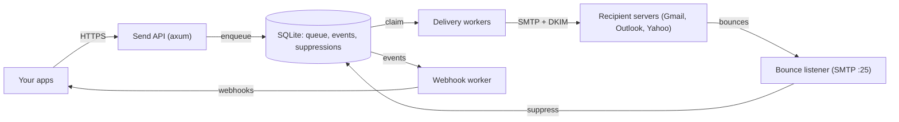

# Sigill — implementation plan

Last updated 2026-11-14.

## Goal and scope

Build a single-tenant email service in Rust, backed by SQLite, that delivers transactional mail and occasional broadcast announcements to users of Erik's own apps, straight from its own MTA and IPs. No third-party relay, all hosting EU-owned.

**In scope**

- HTTP API for the apps to send templated transactional mail, plus a broadcast endpoint for announcements
- Outbound MTA: MX lookup, SMTP delivery over TLS, DKIM signing, per-domain throttling, retries
- Bounce and complaint handling, with an automatic suppression list
- Small broadcast feature: contacts, consent, one-click unsubscribe
- Delivery events sent back to the apps by webhook
- Metrics and a minimal admin view

**Out of scope (v1)**

- Multi-tenancy, customer onboarding, billing
- Inbound mail, mailboxes, IMAP/POP (the only inbound mail is bounces and complaint reports)
- Open and click tracking (may come later; adds privacy and GDPR work)
- Marketing-automation features such as drip campaigns or A/B tests

**Volume assumption:** mostly transactional at low-to-moderate volume. Broadcasts are rare and must never slow down or harm transactional delivery.

## Architecture overview

Everything runs as one binary on one host, around a single SQLite file. The API only writes to the database. A dispatcher hands due deliveries to delivery workers, which connect to recipient MX servers on port 25 from the stream's own IP and record every reply. Asynchronous bounces come back to the bounce listener, which suppresses the address; a webhook worker reports every event to the apps. Transactional and broadcast mail use separate IPs and subdomains on the same host.

## Tech stack and crates

One Cargo workspace, async on Tokio, SQLite compiled into the binary. Fast incremental builds are a requirement (see the build-speed rules below). Check each crate's current version and API with Context7 or docs.rs before using it.

| Concern | Crate(s) | Notes |
| --- | --- | --- |
| Runtime | `tokio`, `tokio-util` | Only the features used; `CancellationToken` for shutdown |
| HTTP API and admin UI | `axum`, `tower-http`, `askama` | Admin pages rendered on the server |
| Database | `sqlx` (`sqlite` feature, bundled SQLite) | Compile-time checked queries in offline mode (`.sqlx/` committed); embedded migrations |
| Backups | Litestream (separate process) | Continuous replication to EU S3-compatible storage |
| Templates | `minijinja`, `mrml` | MJML layouts compiled in native Rust; plain-text part from a separate template |
| MIME building | `mail-builder` | Multipart/alternative, headers |
| DKIM / SPF / DMARC / ARF | `mail-auth` | Signing, verification, report parsing |
| SMTP client | `mail-send` or `smtp-proto` | Outbound delivery; pick after a spike on pooling and source-IP binding |
| SMTP server (bounces) | `smtp-proto` + `tokio` | Minimal receive-only listener |
| MIME parsing | `mail-parser` | Bounce reports (DSN) and complaint reports (ARF) |
| DNS | `hickory-resolver` | MX, A/AAAA, TXT (MTA-STS), PTR checks |
| TLS | `rustls`, `tokio-rustls`, `webpki-roots` | STARTTLS on outbound, TLS on the bounce listener |
| HTTP client | `reqwest` (rustls, minimal features) | Webhooks, MTA-STS policy fetch |
| Config | `figment` | TOML file plus env overrides |
| Logging | `tracing`, `tracing-subscriber` | JSON logs to stdout |
| Errors and analytics | `vaka-sdk` (git, `tracing` feature) | Panics, errors, sessions, analytics events |
| Hashing | `argon2` | API keys |
| Errors | `thiserror`, `anyhow` | Library errors vs. binary errors |
| Testing | `cargo-nextest`, `insta`, `wiremock` | Temp-file SQLite per test, no containers |

**Suggested workspace layout**

- `crates/core`: domain types, config, errors
- `crates/store`: sqlx queries, migrations, connection setup
- `crates/render`: templates to MIME, DKIM signing
- `crates/mta`: dispatcher, delivery workers, DNS, MTA-STS, throttling
- `crates/bounce`: bounce listener plus DSN/ARF parsing
- `crates/api`: axum HTTP API and admin UI
- `bin/sigill`: one binary; `sigill serve` runs API, workers and bounce listener in one process, plus `migrate`, `dns-check` and `dkim-keygen`

**Build-speed rules**

- Split code into the crates above so a change recompiles only what depends on it; keep heavy crates (sqlx, axum) out of crates that don't need them.
- Use the `mold` linker (or `lld`) via `.cargo/config.toml` on Linux.
- Dev profile: `debug = "line-tables-only"`, and no debug info for dependencies.
- `default-features = false` on tokio, reqwest and sqlx, enabling only what is used; avoid proc-macro crates that aren't needed.
- `cargo check` and `clippy` in the inner loop; `cargo nextest` for tests.
- sqlx offline mode (`SQLX_OFFLINE=true`) so builds never need a live database.
- Cache `target/` and `~/.cargo` in CI (for example `Swatinem/rust-cache`).
- Targets: incremental `cargo check` under 5 s, incremental `cargo build` under 15 s, CI build with a warm cache under 3 minutes.

## Data model

One SQLite file holds everything, including the queue. Tables use `STRICT` mode; IDs are UUIDv7 stored as text; JSON goes in text columns. Each message has one row per recipient, so every recipient is retried and tracked on its own.

| Table | Purpose | Key columns |
| --- | --- | --- |
| `apps` | Calling apps and their API keys | id, name, api_key_hash, webhook_url, webhook_secret, default_stream |
| `sending_domains` | Domains we send from | domain, dkim_selector, dkim_keys (encrypted), return_path_domain, verified_at |
| `ip_pools` | Source IPs per stream | name (`transactional`, `broadcast`), ips (JSON array), helo_hostname |
| `templates` | Versioned templates | app_id, key, version, subject_tpl, html_tpl, text_tpl, created_at |
| `messages` | One logical send | id, app_id, idempotency_key, stream, template_key/version, from, subject, rendered_mime (BLOB), created_at |
| `deliveries` | One row per recipient; also the queue | id, message_id, rcpt, rcpt_domain, status (`queued`, `sending`, `sent`, `deferred`, `bounced`, `failed`), attempts, next_attempt_at, last_smtp_code, last_response, priority |
| `delivery_events` | Append-only history | delivery_id, kind (`queued`, `sent`, `deferred`, `bounced`, `complained`, `failed`, `suppressed`), detail, at |
| `suppressions` | Never send to these | address (normalised), reason (`hard_bounce`, `complaint`, `unsubscribe`, `manual`), scope (all or broadcast), source_delivery_id, created_at |
| `contacts` | Broadcast audience | id, app_id, email, name, attributes (JSON), created_at |
| `consents` | Proof of opt-in, GDPR | contact_id, list, granted_at, source, revoked_at |
| `broadcasts` | One announcement | id, app_id, template, segment_query, status, scheduled_at, sent_count |
| `domain_throttle` | Live per-domain limits | rcpt_domain, max_conns, max_per_minute, backoff_until |
| `webhook_outbox` | Events waiting to be POSTed to apps | id, app_id, payload (JSON), attempts, next_attempt_at |

**Rules**

- Unique index on `(app_id, idempotency_key)`: the same key returns the existing message instead of sending twice.
- Queue: the dispatcher selects due rows (`status = 'queued' AND next_attempt_at <= ?`, ordered by priority then time), marks them `sending` in the same write transaction, and hands them to workers. On startup it resets any `sending` rows back to `queued` (crash recovery).
- Connection setup: WAL mode, `busy_timeout = 5000`, `synchronous = NORMAL`, `foreign_keys = ON`, `auto_vacuum = INCREMENTAL`. One writer pool with a single connection plus a separate read pool; keep write transactions short and batch event inserts.
- Indexes on `deliveries(status, next_attempt_at, priority)`, `delivery_events(delivery_id)` and `suppressions(address)`.
- Retention: delete message bodies after 30 days and events after 13 months (both configurable), then run an incremental vacuum.
- The database file lives on local SSD, never on network storage.

## Component specs

### 1. Send API

- axum handlers, JSON in and out.
- `POST /v1/messages`: `{template, version?, to[], from?, variables, stream: "transactional"|"broadcast", headers?, idempotency_key}` returns `202 {message_id, deliveries[]}`.
- `GET /v1/messages/{id}`: status per recipient.
- `POST /v1/broadcasts`, `POST /v1/broadcasts/{id}/send`, `GET /v1/broadcasts/{id}`.
- `PUT /v1/templates/{key}`: upload a new version. `POST /v1/templates/{key}/preview` renders with sample variables.
- `GET/DELETE /v1/suppressions/{address}`; contacts CRUD and consent endpoints.
- Auth: `Authorization: Bearer <api key>`, stored as an argon2 hash. Per-app rate limit.
- Validation: syntax-check every address and reject suppressed ones up front, returning them in the response as `suppressed`.

### 2. Rendering

- MiniJinja for subject, HTML and text; HTML layouts written in MJML and compiled with `mrml` when the template is uploaded.
- Every message is multipart/alternative with a text part and an HTML part, built with `mail-builder`.
- Headers: `Message-ID` on our own domain, `Date`, `From`, and `Return-Path` set to the VERP address (see Bounces). Broadcast messages add `List-Unsubscribe` and `List-Unsubscribe-Post: List-Unsubscribe=One-Click`.
- DKIM-sign each message twice with `mail-auth`, RSA-2048 and Ed25519, on the sending domain. Rotate keys via selectors.

### 3. Queue and scheduler

- A single dispatcher task polls SQLite for due deliveries, marks them `sending` and sends them to per-stream worker pools over `tokio::sync::mpsc` channels. No database locking scheme is needed because one process owns the file.
- Transactional always beats broadcast: priority ordering plus separate worker slots per stream.
- Group by `rcpt_domain`, then by MX host, and send several recipients per SMTP transaction when they share an MX.
- Retry schedule for 4xx and connection errors: 5 min, 15 min, 30 min, 1 h, 2 h, 4 h, then every 4 h until 72 h; then a hard fail and a bounce event.
- Per-domain throttling from `domain_throttle`, with conservative defaults for Gmail, Outlook/Hotmail and Yahoo. Back off for the whole domain on 421 or other rate-limit replies.
- Graceful shutdown with a `CancellationToken`: stop dispatching, finish in-flight sends, put unfinished rows back to `queued`.

### 4. Delivery (MTA)

- Resolve MX via `hickory-resolver`, fall back to A/AAAA, honour null MX (`.`), try MX hosts in preference order.
- IPv4 only at first (IPv6 has stricter rules at Gmail); bind each connection to the stream's source IP.
- EHLO with the pool's `helo_hostname`, which must match the IP's PTR record.
- STARTTLS whenever offered. Enforce MTA-STS policies (fetch, cache, `enforce` mode fails rather than sending in plain text). DANE later.
- Pool and reuse connections per MX within limits; QUIT cleanly.
- Classify every reply: 2xx sent, 4xx defer, 5xx bounce. Store the full text, which carries the diagnostic.

### 5. Bounce and complaint handling

- Most bounces are synchronous 5xx replies during the SMTP session; record and classify those first.
- Return path: `b+<delivery_id>.<hmac>@bounces.<domain>` (VERP with HMAC, so forged bounces are ignored).
- Bounce listener: a receive-only SMTP server (`smtp-proto` + tokio) on port 25 for `bounces.<domain>`. It accepts mail only for valid VERP addresses, rejects everything else at RCPT, and caps message size and connections.
- Parse DSNs (RFC 3464) with `mail-parser`; fall back to heuristics for non-standard bounces.
- Hard bounce (5.1.x unknown user, 5.1.10 null MX, and so on) goes straight onto the suppression list. Soft bounces count, and after 5 in 30 days the address is suppressed.
- Complaints: parse ARF reports (Yahoo CFL, Microsoft JMRP) and suppress at once. Gmail only offers aggregate Postmaster Tools data.

### 6. Broadcast

- Audience = contacts with active consent for the list, minus suppressions, decided when the broadcast starts.
- Uses the broadcast IP and a separate subdomain (for example `news.<domain>`) so its reputation is kept apart from transactional mail.
- Ramp-up: a configurable maximum per hour, so a large broadcast is spread out.
- One-click unsubscribe: `POST /u/<token>` (RFC 8058) and a `GET` confirmation page; both suppress with scope `broadcast`.

### 7. Webhooks to apps

- Events: `delivered`, `deferred`, `bounced`, `complained`, `failed`, `unsubscribed`.
- Written to `webhook_outbox` in the same transaction as the event; a worker POSTs with an HMAC-SHA256 signature header and retries with backoff.

### 8. Admin and observability

- **Errors and crashes in Vaka:** call `vaka_sdk::init` first thing in `main`, with `release` from `CARGO_PKG_VERSION` and key, endpoint and environment from `VAKA_*` env vars. Add `VakaLayer` to the tracing subscriber so `error!` becomes a Vaka issue and `info!`/`warn!` become breadcrumbs. Report handled failures with `capture_error`. Panics and crash-free sessions are captured automatically.
- **Context, no personal data:** tag events with `role` (api, worker, bounce), `stream` and `rcpt_domain`, and add `message_id`/`delivery_id` as breadcrumbs. Never send recipient addresses, subjects or bodies to Vaka; keep scrubbing on.
- **Analytics in Vaka:** `vaka_sdk::track` events `message_queued`, `delivery_sent`, `delivery_deferred`, `delivery_bounced`, `complaint_received`, `unsubscribed`, `broadcast_started` and `broadcast_finished`, with stream and recipient domain as properties. The dispatcher also sends a `queue_depth` event per stream every minute.
- **Alerts as Vaka alert rules:** new issue after a release, queue backlog, bounce rate and defer spikes per domain.
- **Logs:** structured JSON to stdout with `message_id` and `delivery_id` on every line.
- **Admin UI** (askama, server-rendered): search a message, view its events, manage suppressions, see the queue.

## DNS, authentication and deliverability

Gmail, Yahoo and Microsoft reject or junk mail that fails these, so treat every item as a launch requirement. The service should check each record and show it in the admin view.

| Record | Value / rule |
| --- | --- |
| PTR (reverse DNS) | Each sending IP's PTR record names a host (for example `mta1.<domain>`) whose A record points back to that IP; the same name is used in EHLO |
| SPF | `v=spf1 ip4:<ip1> ip4:<ip2> -all` on each sending domain and on the bounce/return-path domain |
| DKIM | `<selector>._domainkey.<domain>` TXT for both RSA-2048 and Ed25519 keys; a CLI command prints the records |
| DMARC | Start `v=DMARC1; p=none; rua=mailto:dmarc@<domain>`, move to `quarantine` then `reject` once reports are clean; DKIM and SPF must align with `From` |
| MX for bounces | `bounces.<domain>` MX pointing to the bounce listener host |
| MTA-STS + TLS-RPT | Optional, for the bounce domain; nice to have, not needed for sending |
| Streams | `mail.<domain>` (transactional) and `news.<domain>` (broadcast) as separate subdomains on separate IPs |

**Operational requirements**

- Outbound port 25 must be open at the host, and inbound 25 for the bounce listener.
- Dedicated IPs with PTR control, checked against Spamhaus and other blocklists before first use.
- IP warm-up: start at a few hundred messages a day per IP and roughly double each day, transactional first. Low but steady daily volume helps build reputation.
- Sign up for Google Postmaster Tools, Microsoft SNDS/JMRP and Yahoo CFL once the domains are live.
- Keep the spam complaint rate well under 0.3% (Gmail's bulk-sender threshold) and bounces under 2%.
- Parse DMARC aggregate reports (`mail-auth` can) and surface failures.

## Milestones

Build in six milestones, each ending in something that runs and is tested. Claude Code should finish and verify one milestone before starting the next.

### M0: Skeleton

- [ ] Cargo workspace with the crates above, `.cargo/config.toml` with the mold linker, CI (fmt, clippy `-D warnings`, nextest) with caching, `docker-compose` with Mailpit
- [ ] Config loading, tracing and `/healthz`
- [ ] Vaka: create a `rust` project for the service, add `vaka-sdk` with the tracing layer, and verify with `vaka send-test-event`
- [ ] SQLite setup: pragmas, writer and read pools, embedded sqlx migrations for all tables, offline mode; `sigill migrate` works
- [ ] Build-speed targets met and checked in CI

### M1: Send to a local sink

- [ ] `POST /v1/messages` with API-key auth, validation and idempotency
- [ ] Template upload and preview; rendering to multipart MIME
- [ ] DKIM signing (RSA + Ed25519), verified in tests with `mail-auth`
- [ ] Dispatcher and workers deliver to Mailpit through a configurable smarthost (dev only)

### M2: Real MTA delivery

- [ ] MX resolution, STARTTLS, MTA-STS, source-IP binding, EHLO name
- [ ] Reply classification, retry schedule, per-domain throttling and backoff
- [ ] Connection pooling; several recipients per transaction for the same MX
- [ ] Integration test against the in-repo fake SMTP server with forced 4xx/5xx replies
- [ ] Manual check: mail to Gmail and Outlook test accounts shows `dkim=pass spf=pass dmarc=pass`

### M3: Bounces, complaints, suppression

- [ ] VERP return paths with HMAC
- [ ] Bounce listener on port 25; DSN and ARF parsing with a fixture corpus of real bounces
- [ ] Suppression list applied at the API and again just before delivery
- [ ] Webhook outbox with signed POSTs

### M4: Broadcast

- [ ] Contacts, consents, broadcasts API
- [ ] Separate IP and subdomain; ramp-up limit per hour
- [ ] RFC 8058 one-click unsubscribe endpoint and headers

### M5: Operations

- [ ] Admin UI: message search, event history, suppressions, queue view
- [ ] `sigill dns-check` (PTR, SPF, DKIM, DMARC, MX) with a pass/fail report
- [ ] DMARC aggregate report ingestion
- [ ] Retention jobs with incremental vacuum; Vaka analytics events and alert rules for queue depth, bounce rate and defer spikes
- [ ] Litestream replication to EU object storage, plus a tested restore onto a fresh host
- [ ] Release builds keep `debug = "line-tables-only"`, or upload debug files with the `vaka` CLI if stripped
- [ ] Runbook: warm-up schedule, key rotation, blocklist response, restore from backup

## Testing strategy

Everything except real-world deliverability must be testable locally, with no network access to external mail servers.

- **Unit:** reply classification, retry schedule, VERP encode/decode, throttling math, template rendering (snapshot tests with `insta`).
- **Parsing corpus:** a `fixtures/bounces/` folder of real DSN and ARF samples (Gmail, Outlook, Yahoo, Postfix, Exim, Exchange), each with its expected classification.
- **DKIM round trip:** sign, then verify with `mail-auth`; check that canonicalisation survives line-ending changes.
- **Integration:** a fresh temp-file SQLite database per test (fast, no containers) plus a controllable fake SMTP server (written in-repo on `smtp-proto`) that can return 2xx, 4xx or 5xx, drop connections or omit STARTTLS on command.
- **Crash recovery:** kill the process mid-send and check that `sending` rows return to `queued` on restart and nothing is sent twice.
- **End to end in dev:** docker-compose with the service and Mailpit; a script sends one of every message type.
- **Load:** queue 100k deliveries against the fake SMTP server; check SQLite write throughput with batching, that throttles hold and that transactional mail keeps its priority during a broadcast.
- **Pre-launch manual checks:** mail-tester.com score, Gmail "Show original" authentication results, Outlook.com inbox placement, and a Litestream restore drill.

## Deployment requirements

The hosting provider is still open. With SQLite the service runs on one EU-owned VPS or dedicated server that owns both sending IPs.

- **Artifacts:** a static Linux binary (musl) and a small container image; no provider SDKs.
- **One process:** `sigill serve` runs the API, dispatcher, delivery workers and bounce listener next to the SQLite file. The API sits behind a reverse proxy for TLS on the same host.
- **Networking:** workers bind to configured source IPs, so containers need host networking (no NAT that changes the source IP). The bounce listener needs inbound 25.
- **State and backups:** one SQLite file on local SSD, replicated continuously by Litestream to EU S3-compatible storage. Recovery means restoring onto a new host and moving the IPs or updating DNS.
- **Secrets:** DKIM private keys, API key pepper, webhook secrets and `VAKA_KEY` from env vars or files, never in the database in plain text.
- **Infra as code:** systemd units for `sigill` and Litestream, plus a sample `docker-compose.prod.yml`.
- **Provider checklist** (to fill in when choosing): outbound 25 allowed, PTR editable, at least 2 dedicated IPv4 on the same server, local SSD, clean IP range, EU-owned company.

## Open decisions

- [ ] Hosting provider and IPs (see the provider checklist above)
- [ ] Sending and bounce domains, and subdomain names for the two streams
- [ ] EU object storage for Litestream backups
- [ ] `mail-send` vs. `smtp-proto` for the SMTP client (decide after a spike in M2)
- [ ] Open/click tracking: leave out, or add later behind a flag
- [ ] When to move to Postgres: only if a second sending host or automatic failover becomes necessary
